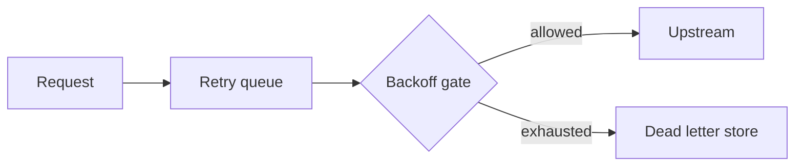

# Retry policy for the billing connector

## Executive summary

Use a 2,000 ms deadline with two retries behind a bounded queue. The field data puts the slowest one percent of calls at 1,830 ms, which leaves little room, so the third retry is the first thing to cut when the budget tightens. Confidence is moderate: one field study carries most of the weight.

## Question

What deadline and retry count should the billing connector use so that tail latency stays inside the user-facing budget?

## Findings

- The slowest one percent of calls took 1,830 ms across four regions ([latency study](https://example.org/latency-study)).
- Retries beyond the second attempt added 12% to tail latency and did not improve success ([latency study](https://example.org/latency-study)).
- The user-facing deadline in the reliability guide is 2,000 ms ([SRE guide](https://example.org/sre-guide)).

## How it works

A request enters a retry queue that holds at most 64 entries and releases one request at a time. Bounding the queue is what keeps memory flat when the upstream slows down: a slow call occupies the single slot, later requests wait their turn, and the queue refuses new entries once it is full instead of growing without limit.

Each attempt then passes the backoff gate. The gate lets a request through to the upstream when its wait has elapsed, and doubles the wait after every failure. After the second failure it sends the request to the dead letter store, so a request that keeps failing stops competing with fresh work.

The deadline is the sum of these waits and the upstream's own time. With the slowest one percent of calls at 1,830 ms, a single attempt already uses most of a 2,000 ms budget, which is why a third attempt cannot fit and why the extra retries in the study only added tail latency.

The retry queue sends each request through the backoff gate, which either admits it to the upstream or parks it in the dead letter store.



## Decisions

- Set the deadline to 2,000 ms and allow two retries.
- Bound the retry queue at 64 entries.

## Rejected options

- Unlimited retries: the study shows extra attempts add latency and no successes. A retry without a backoff is a second outage waiting to happen ([SRE guide](https://example.org/sre-guide)).

## Margin

```calc
tail_ms = 1830 @ https://example.org/latency-study
budget_ms = 2000 @ https://example.org/sre-guide
headroom_ms = budget_ms - tail_ms
headroom_pct = headroom_ms / budget_ms * 100
```

The slowest calls leave 170 ms of room (derived: headroom_ms), which is 8.5% of the budget (derived: headroom_pct).

## Confidence

Moderate. One field study supplies the latency figures and the retry result; the deadline comes from a guide, not from this system's own users.

## Gaps

- No measurement exists for this connector's own upstream, only the study's four regions.
- The study does not report success rates per attempt, so the value of the second retry is inferred.

## Scope

- In scope: the deadline, the retry count and the queue bound for the billing connector.
- Out of scope: retry jitter, circuit breaking and capacity planning.

## Contradictions

- None found after checking 2 sources.

## Sources

- [Latency study](https://example.org/latency-study)
- [SRE guide](https://example.org/sre-guide)
