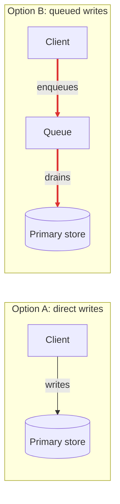

# Research Report Template

## Output Format

**The final research report MUST be a Markdown file**, saved to the project working directory.

**File naming**: `research_[topic]_[timestamp].md`
- Example: `research_ai-coding-assistants_20260312.md`
- Save to the current working directory, or `~/.agent/research/` if no project context

**CRITICAL BOUNDARY**: This is a RESEARCH REPORT ONLY, no implementation. Do not write code, make architectural decisions, or implement findings. The user decides next steps after reading the report.

---

## Report Structure

Adapt section depth based on research depth level (see table at bottom).

```markdown
# [Research Topic Title]

**Date:** YYYY-MM-DD
**Depth:** quick | standard | deep | exhaustive
**Confidence:** XX%
**Sources:** N sources from N search rounds

---

## Executive Summary

2-4 sentences directly answering the core research question.
Lead with the answer, not the process. The reader should understand your conclusion without reading anything else.
State overall confidence level and the most important caveat upfront.

## Key Findings

1. **Finding Title**, One-sentence summary with evidence. [Source](https://example.com/page)
2. **Finding Title**, One-sentence summary with evidence. [Source](https://example.com/page)
3. **Finding Title**, One-sentence summary with evidence. [Source](https://example.com/page)
...

Findings should be ordered by importance, not by search order.
Each finding should be a standalone insight, not a source summary.

## Detailed Analysis

This is the CORE of the report, not a repeat of Key Findings with more words.

### Sub-question 1: [Question]

[Multi-paragraph ANALYSIS, not a list of "Source X says Y" bullets]

Structure each sub-question analysis as:
1. **Opening statement**, your analytical conclusion for this sub-question (1-2 sentences)
2. **Evidence and reasoning**, support the conclusion with specific evidence from multiple sources, explain WHY the evidence supports the conclusion
3. **Nuance and caveats**, what complicates the picture, what the limitations are
4. **Connection to other sub-questions**, how this finding relates to or builds upon other sub-questions

> Key quote or data point, [Source Name](url)

**Cross-reference**: This finding connects to Sub-question N because [explanation].

### Sub-question 2: [Question]

Building on the findings from Sub-question 1, ...

[Analysis continues with explicit connections to previous sub-questions]

## Comparison (if applicable)

| Criterion | Option A | Option B | Option C |
|-----------|----------|----------|----------|
| Feature 1 | ✅ Supported | ❌ Not available | ⚠ Partial |
| Feature 2 | ... | ... | ... |
| Pricing   | $X/mo | Free | $Y/mo |

**Analysis of the comparison:**

[2-3 paragraphs explaining what the table reveals, patterns, key differentiators,
 surprises, and what matters most for the user's context. The table is data;
 this narrative is the insight.]

## Contradictions & Debates

Actively identify and analyze disagreements. "No contradictions found" is almost never true
for non-trivial research, look harder.

Types of contradictions to look for:
- Vendor claims vs independent testing/reviews
- Different sources citing different numbers or dates
- Optimistic vs pessimistic assessments of the same technology
- Marketing language vs technical reality

For each contradiction:
- **[Topic]**: Source A ([url]) claims "X", while Source B ([url]) argues "Y".
  **Evidence weight**: [which side has stronger evidence and why]
  **Resolution**: [your assessment, which claim is more likely accurate, or is the truth somewhere in between]

## Uncertainties & Gaps

- ⚠ **[Topic]**: No reliable data found. Latest source from YYYY.
- ⚠ **[Topic]**: Only Tier 3-4 sources available, claims not independently verified.
- ⚠ **[Topic]**: Information may be outdated (pre-YYYY).
- ⚠ **[Topic]**: All sources originate from the same entity (vendor/PR), independent verification needed.

## Recommendations

### Primary Recommendation
[Recommendation with clear reasoning tied to specific evidence from findings.
 Not just "use X" but "use X because evidence shows [specific reasons], particularly
 relevant given [user's context]."]

### Alternative
[When to consider this instead, specific different constraints or priorities
 that would change the recommendation]

### Not Recommended
[What to avoid and why, tied to specific evidence, not just opinion]

## Search strategy and screening

Required for a `literature` review or any systematic search. Omit for a quick
factual question.

- **Databases**: at least three, with the provider that served each
- **Queries**: the exact strings, and the date each was run (the ledger has
  provider, query, status, result count and timestamp)
- **Inclusion criteria**: 
- **Exclusion criteria**: 
- **Counts**: identified N, screened N, full-text N, included N
- **Limitations**: preprints included? one database only? date range? language?

## Methodology

- **Depth**: [quick|standard|deep|exhaustive]
- **Search rounds**: N rounds, M total queries
- **Final confidence**: XX% (from research_checkpoint)
- **Sub-questions**: N defined, N answered, N partially answered
- **Multi-hop chains used**: [brief description of entity expansions, temporal progressions, etc.]
- **Key challenges**: [brief note on any difficulties encountered]

## Sources

The report must pass the docs-qa gate (`scripts/docs_qa.py`); `research_finalize` runs it
and fails on any error. Avoid em and en dashes above all.

The finalizer generates `sources/INDEX.md` from the evidence ledger and
archives each extracted source with a SHA-256. Cite papers by DOI, arXiv ID or
PMID where available, and pin a line or section when the extracted text exposes
one. Do not hand-write hashes; `research_finalize` computes them.

| # | Title | URL | Date | Credibility |
|---|-------|-----|------|:-----------:|
| 1 | [Title] | [url] | YYYY-MM-DD | ⭐ Tier 1 |
| 2 | [Title] | [url] | YYYY-MM-DD | 🔵 Tier 2 |
| 3 | [Title] | [url] | YYYY-MM-DD | 🟡 Tier 3 |
| 4 | [Title] | [url] | YYYY-MM-DD | 🔴 Tier 4 |
```

---

## Diagrams

A diagram earns its place when it shows structure prose cannot: a process, a timeline, a dependency
or a comparison with figures. Use a fenced `mermaid` block (flowchart, sequenceDiagram, timeline,
pie, xychart-beta and the other standard types). Rules, enforced by `research_finalize`:

- The block must start with a real diagram type and have balanced brackets and quotes.
- A figure in a label (a percentage, a decimal, a number of three or more digits) must appear in a
  source named inside the block with a comment line: `%% source: https://...`. The source must be one the
  tools returned. A diagram with figures and no source fails.
- A `pie` or `xychart-beta` chart must plot figures that appear in a table in the report: put the table first, cite its rows, then chart it. Each plotted label and value must be in one row.
- A purely structural diagram needs no source. Put the caption and a cited sentence beside it.

### Choosing and sizing a diagram

Ask first: would the reader learn more from this than from a table or a paragraph? If a three-column table
says the same thing, use the table. Then remove what you can: merge two nodes that always travel together,
drop an arrow the layout already implies. Keep to nine nodes and twelve arrows; past that it is an overview
plus a detail. Lint warns at those limits. Pick the Mermaid type by what you are showing:

| Showing | Mermaid type |
|---|---|
| Components and connections, decision logic, a process | `flowchart` |
| Time-ordered messages between actors | `sequenceDiagram` |
| States, transitions and guards | `stateDiagram-v2` |
| Entities and relationships | `erDiagram` |
| Events or tasks over time | `timeline`, `gantt` |
| Two-axis positioning | `quadrantChart` |
| A quantity across categories or parts of a whole (backed by a table) | `xychart-beta`, `pie` |
| What an experience feels like across stages | `journey` |

A `flowchart` (one level of subgraphs, cycles allowed), a `stateDiagram-v2` or a `sequenceDiagram` with no
decisions, fragments or composite states, arrow labels of 14 characters or fewer (28 in a sequence) and nine nodes
or fewer is drawn in the report's editorial style; anything else is drawn by Mermaid and finalize says
why. Short labels cost nothing, so prefer them.

### Comparing options

Draw the difference, not two separate boxes. Put each option in its own subgraph with the same
endpoints, and style the edges that one option adds so the reader can point at what they are choosing
between. Edge numbers in `linkStyle` count in the order the edges are written, starting at 0.



Option B adds a queue between the client and the store, which buys ordering and costs a hop of delay.

## Writing Quality Anti-Patterns

These are the patterns that make reports feel shallow. Avoid them:

### ❌ Source-dump style (DON'T)
```
### Sub-question: What is Product X's market position?

- Product X officially states in "Introducing X" that it is "...". [Source](https://example.com/page)
- The official GitHub repo positions it as "...". [Source](https://example.com/page)
- Public timeline: community sources record the first commit date as... [Source](https://example.com/page)
```

### ✅ Analytical style (DO)
```
### Sub-question: What is Product X's market position?

Product X occupies a unique position as the only open-source option in a market
dominated by cloud services. Its self-hosted architecture [Source](https://example.com/page) gives it
a clear differentiation on data sovereignty, which explains why enterprise adoption
has grown 3x since launch [Source](https://example.com/page).

However, this positioning creates a tension: the self-hosting requirement raises
the barrier to entry, which is precisely the gap that cloud derivatives like
Y and Z have rushed to fill (see Sub-question 3). The fact that 5+ companies
launched hosted versions within weeks [Source](https://example.com/page) suggests the core technology
is compelling but the deployment model is a bottleneck.

> "We saw 70% of inquiries asking for a managed version", [CTO interview](url)

This dynamic, strong technology held back by deployment friction, is the central
theme that connects all the competitive products examined in this report.
```

---

## Sections the finalizer requires

`research_finalize` looks for these exact `##` headings, so the display titles above map to
them: "Key Findings" is `## Findings`, "Uncertainties & Gaps" is `## Gaps`, and
"Contradictions & Debates" is `## Contradictions`.

```markdown
## Question
## Findings
- Latency fell 12.5% after the change [F3] ([source](https://example.com/a))
## Decisions
## Rejected options
## Confidence
## Gaps
- One real limit, unanswered question or weak source. "None" fails.
## Scope
- In scope: what the report covers.
- Out of scope: what it deliberately leaves out.
## Contradictions
- Source A says 5 ([a](https://a.example/x)); source B says 6 ([b](https://b.example/y)).
- Or: None found after checking N sources.
## Sources
```

Each Findings line carries an `[F#]` evidence ID from `research_notes` when notes exist, and
each figure or quote must appear in the cited source.

## Section Requirements by Depth

| Section | Quick | Standard | Deep | Exhaustive |
|---------|:-----:|:--------:|:----:|:----------:|
| Executive Summary | ✅ 2 sentences | ✅ 3-4 sentences | ✅ 4+ sentences | ✅ Full paragraph |
| Key Findings | 3-4 items | 4-6 items | 6-8 items | 8+ items |
| Detailed Analysis | ❌ Skip | ✅ 1-2 ¶/question | ✅ 2-3 ¶/question with cross-refs | ✅ Full detail + quotes + cross-refs |
| Comparison | If applicable | If applicable | ✅ Required if comparing + narrative | ✅ Required + narrative analysis |
| Contradictions | ❌ Skip | ⚠ If found | ✅ Required + resolution | ✅ Required + detailed resolution |
| Uncertainties & Gaps | ❌ Skip | ⚠ If found | ✅ Required | ✅ Required |
| Recommendations | ❌ Skip | ✅ Primary only | ✅ Primary + Alt | ✅ Full (Primary + Alt + Not Rec) |
| Methodology | ❌ Skip | ✅ Brief | ✅ Detailed | ✅ Full with multi-hop description |
| Sources Table | ✅ Required | ✅ Required | ✅ Required | ✅ Required |

## Quality Requirements

- **Every claim must have a source**, inline `[Source](https://example.com/page)` citation
- **Sources table is non-negotiable**, every referenced URL must appear
- **Confidence levels must be honest**, match the final `research_checkpoint` score
- **Contradictions must be surfaced**, don't silently pick one side
- **Tier 3-4 only claims must be flagged**, mark as unverified in Uncertainties
- **Dates matter**, always note when information was published
- **Facts vs opinions clearly separated**, use "Source claims..." for unverified assertions
- **Sub-questions must cross-reference each other**, required for deep/exhaustive
- **Comparison tables must have narrative analysis**, a table alone is data, not insight
- **Detailed Analysis must contain original analysis**, "Source X says Y" repeated is NOT analysis
